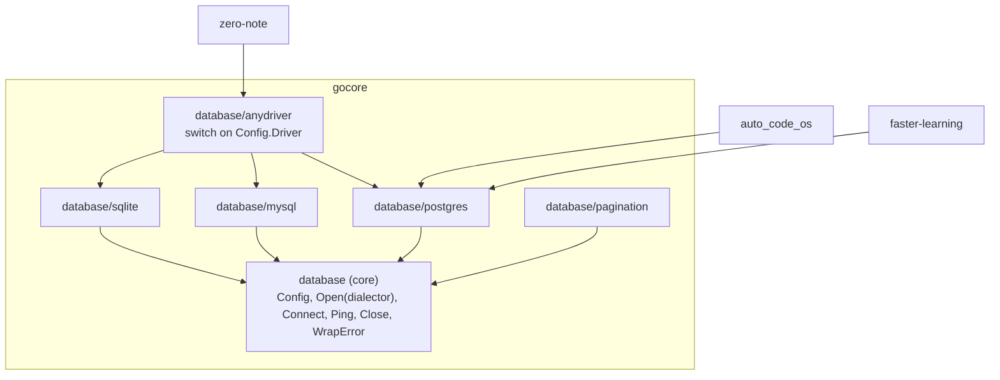

# Design: gocore v0.3.0 consumer fit

## Key Decisions
- **Decision:** The core `database` package connects through a caller-supplied `gorm.Dialector`; drivers live in sub-packages.
- **Reason:** Go links and vendors per package. A driver import inside `database` reaches every consumer; an import inside `database/sqlite` reaches only those who import that package.

- **Decision:** Runtime driver choice is a separate opt-in package, `database/anydriver`.
- **Reason:** zero-note picks Postgres or SQLite from configuration. A registry filled by blank imports would need `init()` and package-level state, which CS-1 and CS-2 forbid. An explicit switch in one package keeps the cost visible.

- **Decision:** Token type is a claim (`typ`) written by `JWTSigner` and checked by `JWTValidator` when `JWTConfig.TokenType` is set.
- **Reason:** Access and refresh tokens signed with the same secret are otherwise interchangeable. Using two secrets would also work but needs every consumer to manage a second secret; a typed claim fixes it with one config field and keeps one secret.

- **Decision:** Claim names are configurable (`IDClaim`, `RolesClaim`) with defaults that reproduce v0.2.0.
- **Reason:** Lets existing token formats (zero-note's `userId`) use `iam` without a token-format migration, while a config that does not set them behaves exactly as before.

## Approach
Package-level split inside the existing module rather than new modules. The measured bloat (`go-sqlite3`, MySQL driver in `auto_code_os/vendor`) comes from package imports, so moving the imports is enough. Multi-module would add a tag per module and `replace` juggling for no further gain at three consumers.

## Alternatives Considered
| Alternative | Why rejected |
|---|---|
| Separate Go module per driver (`gocore/database/postgres` with its own `go.mod`) | Same vendor result as packages, plus per-module tags and version skew between core and drivers. |
| Keep `database.New` and deprecate it | It must import all drivers to work, so the bloat stays for everyone until removal. |
| Driver registry with `init()` registration (like `database/sql`) | Violates CS-1 (no `init`) and CS-2 (no package-level mutable state). |
| Move `auto_code_os` to Gin | Large rewrite (Chi routes across ~3k lines) to use gocore features it does not need. |
| Separate secrets for access and refresh tokens in zero-note only | Fixes one service, leaves the gap in `iam` for the next one. |
| `net/http` auth middleware now | No consumer needs it; added when one does (YAGNI). |

## Architecture


`gorm.io/driver/*` imports exist only in their sub-package. `database` itself imports `gorm.io/gorm` and nothing driver-specific.

## Interfaces & Contracts

### database (core)
```go
// Open connects through dialector with pooling, ping and bounded retries, returning the Database wrapper.
func Open(ctx context.Context, dialector gorm.Dialector, cfg Config, opts ...Option) (Database, error)

// Connect is Open without the wrapper, for callers that want the *gorm.DB directly.
func Connect(ctx context.Context, dialector gorm.Dialector, cfg Config, opts ...Option) (*gorm.DB, error)
```
`Config` keeps all fields. `Config.Driver` is read only by `anydriver`; the core ignores it. The DSN validation, retry loop (context-aware, capped backoff, closes the pool of a failed attempt), pool settings and logger selection move unchanged from the current `connect`.

### database/postgres, database/mysql, database/sqlite
```go
func New(ctx context.Context, cfg database.Config, opts ...database.Option) (database.Database, error)
func Open(ctx context.Context, cfg database.Config, opts ...database.Option) (*gorm.DB, error)
```
Each is a few lines: build the dialector from `cfg.DSN` and call the core.

### database/anydriver
```go
// New selects the driver from cfg.Driver ("postgres" or "" , "mysql", "sqlite").
// Unknown drivers return CodeValidationFailed with a FieldError on "driver".
func New(ctx context.Context, cfg database.Config, opts ...database.Option) (database.Database, error)
```

### iam
```go
type JWTConfig struct {
    Secret        string        `json:"-"`
    SigningMethod string
    Issuer        string
    Audience      string
    ClockSkew     time.Duration
    IDClaim       string // claim holding the user id; default: "sub", then "id"
    RolesClaim    string // claim holding roles (string or []string); default: "roles", then "role"
    TokenType     string // when set: signer writes "typ", validator requires it to match
}
```
- `IDClaim` set: only that claim is read (string or number). Not set: v0.2.0 behaviour.
- `RolesClaim` set: that claim is read as `[]string` or a single string. Not set: v0.2.0 behaviour.
- `TokenType` set: `Sign` writes `typ`, overriding any `typ` in `extra`; `Validate` rejects a missing or different `typ` with `CodeUnauthorized` / `KeyUnauthenticated`. Not set: `typ` is ignored.
- A missing id claim stays as today (empty `Identity.ID`); callers that require it already check.

### zero-note auth after migration
- Access config: `TokenType: "access"`, `IDClaim: "userId"`, `RolesClaim: "role"`.
- Refresh config: same secret, `TokenType: "refresh"`.
- Protected routes use `iamgin.JWTMiddleware(accessValidator)`. The use case reads the user with `iam.IdentityFromContext(ctx)` from the request context (`c.Request.Context()`), never `*gin.Context`.
- `RefreshToken` validates with the refresh validator.

## Security Boundaries
- Access and refresh tokens become non-interchangeable once `TokenType` is set on both sides. Verified by tests that present each token to the other validator.
- A config without `TokenType` gives no type protection; `iam/README.md` states that services issuing more than one kind of token must set it.
- Claim configuration only changes where values are read from; signature, method, issuer, audience and expiry checks are unchanged.

## Performance Considerations
N/A. Connection setup and claim reading are unchanged in cost; the split only removes code from binaries.

## Observability
### Metrics
N/A.
### Logging
- Unchanged connection logs (driver name now comes from the sub-package: `postgres`, `mysql`, `sqlite`).
### Tracing
N/A.

## Risks
| Risk | Mitigation |
|---|---|
| Consumers miss the removed constructors | Compile errors; CHANGELOG migration list; the three consumers are migrated in this task. |
| zero-note logout wave after deploy | Expected and documented; access token lifetime is 15 minutes, refresh 7 days, so users re-login once. |
| `anydriver` silently becomes the default import, bringing bloat back | README recommends driver packages first; archtest keeps driver modules owned by their sub-packages only. |
| Pagination tests rely on SQLite from `database` | Test imports switch to `database/sqlite`; archtest owner list updated. |
