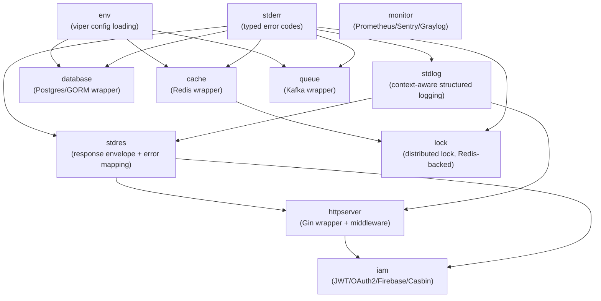

# Design: gocore Foundation

## Key Decisions
- **Decision:** Flat top-level packages (`stderr/`, `stdres/`, `stdlog/`, `database/`, ...), one Go module.
  **Reason:** Keeps import paths short; each package can be adopted independently by a consuming service without pulling in unrelated deps.
- **Decision:** `stderr` is the single source of typed errors; every other package returns/wraps `stderr.Error`, never raw driver errors.
  **Reason:** Lets `stdres` and `stdlog` map any error to an HTTP status + log level + response body with one code path, instead of per-package special-casing.
- **Decision:** Each infra wrapper (`database`, `cache`, `queue`, `lock`) owns its own `Config` struct decoded independently via viper, not a shared global config object.
  **Reason:** A service only pays for what it configures; avoids one giant config struct coupling unrelated packages together.
- **Decision:** `iam` is isolated from infra packages — no infra package imports `iam`, and `iam` does not import `database`/`cache` directly (it depends on interfaces, e.g. a token/session store, that a service wires up).
  **Reason:** Keeps Casbin/Firebase/OAuth2 dependencies out of services that only need `database`/`cache`, per the invariant in specs.md.
- **Decision:** Gin is the only HTTP adapter in v1; `httpserver` package exposes an interface (`Router`, middleware signature) that a future ConnectRPC adapter could satisfy, but no second implementation ships now.
  **Reason:** Avoid speculative abstraction cost — build the interface seam cheaply, defer the second implementation until there's a real consumer (Golden Rule: avoid speculative design).

## Approach
Build gocore bottom-up: `stderr` first (nothing depends on anything), then `stdlog`/`stdres` (depend only on `stderr`), then infra wrappers (depend on `stderr`+`stdlog`+`env`), then `httpserver` (depends on `stderr`/`stdres`/`stdlog`), then `iam` last (depends on `stderr`/`stdlog`/`httpserver` for middleware integration). This ordering means every later package can be built and tested against a stable foundation, and mirrors the phase order in tasks.md.

Each package's public API is a small set of constructor functions (`New*`) returning a concrete type or narrow interface — no framework-wide DI container, no init()-based global registration. This matches the proposal's "no hidden global state" decision and keeps a service's `main.go` wiring explicit and greppable.

## Alternatives Considered
- **Include domain-specific integrations (blockchain/payment/email/socket/crypto packages):** Rejected — those are domain-specific integrations unrelated to the "chassis" goal; including them would bloat the module and its dependency tree for every consumer. (See proposal Non-goals.)
- **Single shared `Config` struct for all infra (like some monolithic frameworks):** Rejected — couples packages that should be independently importable, and forces every service to define config for infra it doesn't use.
- **Nest everything under `pkg/` (matching `kdc_bike_BE`'s own convention):** Rejected per user decision — flat layout chosen to keep import paths short and modular; `kdc_bike_BE` will adapt to `gocore`'s layout when it migrates, not the other way around.
- **Framework-agnostic HTTP layer from day one (Gin + ConnectRPC both in v1):** Rejected for v1 — `kdc_bike_BE` only needs Gin; building a second adapter now is speculative until a real ConnectRPC consumer exists.

## Architecture


## Interfaces & Contracts

**`stderr`**
```go
type Code int // classed ranges: 1xxx=validation/bad_request, 4xxx=client (not-found/unauthorized/forbidden), 5xxx=internal

type FieldError struct {
    Field   string `json:"field"`
    Message string `json:"message"`
    Tag     string `json:"tag,omitempty"`
}

type Error struct {
    Code    Code         `json:"code"`
    Message string       `json:"message"`
    Key     string       `json:"-"` // i18n key
    Args    []any        `json:"-"` // i18n arguments
    Details []FieldError `json:"details,omitempty"`
    Err     error        `json:"-"` // wrapped cause
}
func New(code Code, message string) *Error
func Wrap(code Code, err error) *Error
func (e *Error) WithDetails(details ...FieldError) *Error
func (e *Error) WithKey(key string, args ...any) *Error
func (e *Error) WithCause(err error) *Error
func (e *Error) HTTPStatus() int // deterministic mapping from Code class
func (e *Error) Error() string
func (e *Error) Unwrap() error
```

**`stdres`**
```go
type Envelope struct {
    Code    int    `json:"code"`
    Message string `json:"message"`
    Data    any    `json:"data,omitempty"`
    Details any    `json:"details,omitempty"`
}

type Translator interface {
    Translate(ctx context.Context, key string, args ...any) string
}

func Success(data any) Envelope
func FromError(err error) (Envelope, int) // int = HTTP status; unwraps stderr.Error if present
func JSON(c *gin.Context, status int, data any)
func OK(c *gin.Context, data any)
func Created(c *gin.Context, data any)
func NoContent(c *gin.Context)
func Error(c *gin.Context, err error)
func HandleValidationErrors(c *gin.Context, target any, err error)
```

**`stdlog`**
```go
// Built on Go standard library log/slog with context propagation and sensitive field redaction
type Logger struct { ... }
func New(opts ...Option) *Logger
func (l *Logger) WithContext(ctx context.Context) *Logger
func (l *Logger) Debug(msg string, args ...any)
func (l *Logger) Info(msg string, args ...any)
func (l *Logger) Warn(msg string, args ...any)
func (l *Logger) Error(msg string, args ...any)
func LevelFor(err error) slog.Level
```

**`database`**
```go
type Config struct {
    DSN string
    MaxOpenConns, MaxIdleConns int
    ConnMaxLifetime time.Duration
    RetryAttempts int
    RetryBackoff time.Duration
}
func NewPostgres(cfg Config) (*gorm.DB, error)
```

**`cache`**
```go
type Config struct {
    Addr, Password string
    DB int
    DialTimeout, ReadTimeout, WriteTimeout time.Duration
}
func NewRedis(cfg Config) (*redis.Client, error)
```

**`lock`**
```go
func Acquire(ctx context.Context, client *redis.Client, key string, ttl time.Duration) (*Lock, error)
func (l *Lock) Release(ctx context.Context) error
```

**`iam`**
```go
type TokenValidator interface {
    Validate(ctx context.Context, token string) (Identity, error)
}
func JWTMiddleware(v TokenValidator) gin.HandlerFunc
func CasbinMiddleware(enforcer *casbin.Enforcer) gin.HandlerFunc
```

Exact field names/signatures may be refined during implementation; the contract to preserve is: constructors take an explicit `Config`, infra errors are `stderr`-typed, and middleware is standard `gin.HandlerFunc`.

## Security Boundaries
- `iam` validates JWT signature and expiry before populating any identity in request context — no partial/unverified identity ever reaches a handler (see specs.md Failure Scenario: JWT invalid or expired).
- Casbin enforcement happens in middleware, before the handler runs — handlers never need to re-check authorization for routes already covered by `CasbinMiddleware`.
- Secrets (DB passwords, Redis auth, OAuth client secrets, Firebase service account) are only ever read from config (env/viper), never hardcoded or logged. `stdlog` must not log raw config structs that could contain secrets — log specific safe fields only.

## Performance Considerations
- N/A for v1 in the sense of a specific throughput target (this is a library, not a deployed service) — but wrapper defaults matter:
- **Connection pooling:** `database`/`cache` default pool sizes should be conservative (e.g. 10-25 connections) and fully overridable via `Config`.
- **Retry/backoff:** default bounded exponential backoff (e.g. 3 attempts, starting 100ms) — must not retry indefinitely and block startup.
- **Known bottleneck:** Casbin policy evaluation on every request if misconfigured with a large/unindexed policy set — out of scope to optimize in v1, document as a caveat.

## Observability

### Metrics
- `gocore.database.connect.duration` — histogram, time to establish DB connection
- `gocore.database.query.errors_total` — counter, by error class
- `gocore.cache.op.errors_total` — counter, by operation
- `gocore.lock.acquire.failures_total` — counter
- `gocore.http.request.duration` — histogram, by route/status (via `httpserver` middleware)
- Exposed via `monitor` package's Prometheus registry.

### Logging
- INFO: successful infra client initialization (host redacted of credentials), request start/end via `httpserver` middleware
- WARN: retry attempt N/M for transient infra failure, with backend name and attempt count
- ERROR: retries exhausted / unrecoverable `stderr` internal errors, with error code and wrapped cause
- Never log: raw tokens, passwords, full connection DSNs

### Tracing
N/A for v1 — no distributed tracing integration in this proposal; `stdlog` accepting `context.Context` leaves the door open for a future trace-ID propagation without an API change.

## Risks
- **Scope creep across 3 pillars in one module:** Mitigated by strict phase sequencing in tasks.md and the Non-goals list in proposal.md — each phase ships independently testable/usable code.
- **`iam`'s multiple auth backends (Casbin/JWT/OAuth2/Firebase) increase surface area for subtle security bugs:** Mitigated by keeping each backend behind a narrow interface (`TokenValidator`) and writing failure-path tests (expired/malformed/wrong-signature tokens) per specs.md.
